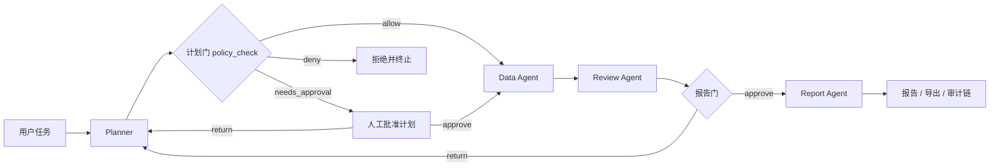

# 企业流程自动化多 Agent 平台

轻量级工作流平台示例：用户以自然语言提交任务，Planner 从代码注册的只读、幂等工具中规划依赖 DAG（最多 6 步），执行前经过确定性策略检查和计划审批门，Data Agent 拓扑执行，Review Agent 检查资料并等待报告门确认，Report Agent 生成带来源的报告。

典型多步编排：`query_supplier_registry` 查询供应商登记记录，将记录中的类别通过 `$ref` 传给 `search_local_docs` 检索准入制度，再读取匹配文档，最终报告同时引用清单记录和制度文档的来源 ID。

## 架构与两道门



计划门由确定性策略触发：计划包含 `medium` 风险或需要审批的工具，或任务命中敏感关键词（付款、转账、合同签署、个人信息、权限变更、删除）。是否审批不交给 LLM 判断。报告门保留原有“审核后交付”语义，两者共同对应“先批方案、再批结果”。

## Agent 职责

- **Planner（LLM）**：理解用户任务，输出结构化工具计划；工具名、参数、结果依赖和 DAG 均由程序校验。
- **Policy（确定性治理层）**：注册工具必须声明风险等级、是否需审批和数据范围；执行每一步前做 default-deny 策略检查。
- **Data Agent（确定性工具执行器）**：不调用 LLM，只执行通过策略检查的注册工具并传递上游结果。
- **Review Agent（LLM）**：检查资料支持情况、缺口与人工确认问题。
- **Report Agent（LLM）**：组织报告。摘要和每条事实声明都必须引用审核通过的来源 ID。

## 安全和状态

- 当前只允许**只读且幂等**的注册工具，工具失败可有限重试。本期不提供写工具。
- 工具治理采用 default-deny：未注册工具、非只读/幂等工具、`high` 风险工具在执行层直接 `deny` 并终止；`medium`、`requires_approval` 或 `restricted` 工具必须先通过计划门。

  | 工具 | risk_level | requires_approval | data_scope |
  | --- | --- | --- | --- |
  | `search_local_docs` | low | false | internal |
  | `read_local_doc` | low | false | internal |
  | `query_supplier_registry` | medium | true | internal |
- `read_local_doc` 只解析 `workflow/sample_docs` 下的 Markdown/TXT，并在解析符号链接后的路径仍位于该目录时才读取。
- 文档摘录始终作为不可信数据输入模型，不能覆盖 system 规则或触发额外工具调用。
- 检索使用项目内 BM25 实现：英文/数字按词，连续中文按相邻双字切词。小型静态语料不需要 embedding 服务，得分确定、易于离线评估。
- `query_supplier_registry` 只读仓库内静态演示清单 `sample_data/suppliers.csv`，支持按供应商 ID、名称或状态筛选，最多返回 5 条记录；来源 ID 为稳定的 `supplier:<供应商ID>`，行摘要截断到 220 字。
- 工具输出只保留来源 ID 和最多 900 字的摘录；checkpoint 不保存整篇文档或原始 CSV。轨迹使用 LangGraph reducer 追加 `events`，每条事件带递增 `seq`、`prev_hash` 和 `entry_hash`，导出时按顺序重算 SHA-256 哈希链；篡改任意事件会使校验失败。审计链只对本次变更后的新运行有效，旧 checkpoint 事件没有哈希，不做静默补链。
- 引用合法不等于语义支持。`source_id` 校验只证明引用了审核通过的来源，不证明摘录真的支持这句话。本平台用 token 覆盖率做确定性启发式标记（阈值 0.5），只用于提示人工复核，不等价于语义蕴含判断；同义改写、跨段推理会漏判。这一提醒借鉴 CiteProof：校验只证明引用了，不证明支持了。
- 上游步骤因空结果被跳过时，依赖它的后续步骤也标记为跳过，由 Review 说明资料缺口，不会让后续 `$ref` 解析失败中断流程。
- 工具结果按规范化后的 `(工具名, 参数)` 缓存。人工退回触发重新规划时，完全相同的只读调用复用成功结果。
- 状态：`running` 表示执行中；`awaiting_plan_approval` 表示等待计划审批；`awaiting_human` 表示等待报告审批；`succeeded` 表示报告完成；`failed` 表示工具或系统出错；`terminated` 表示退回达到上限。计划门和报告门各最多退回两次。
- SQLite LangGraph checkpointer 是状态来源；FastAPI `BackgroundTasks` 用于本地演示，不保证进程退出后后台任务继续运行。

## 安装和启动

从仓库根目录执行（需要 Python 3.11+）：

```powershell
python -m pip install -r .\workflow\requirements.txt
python -m workflow.api
```

另开一个终端启动界面：

```powershell
python -m streamlit run .\workflow\dashboard.py
```

API 默认 `http://127.0.0.1:8001`，Streamlit 默认 `http://127.0.0.1:8501`。真实模型在 `workflow/.env` 配置：默认 provider 为 SiliconFlow，需要 `SILICONFLOW_API_KEY`；切回通义则设置 `WORKFLOW_LLM_PROVIDER=dashscope` 并提供 `DASHSCOPE_API_KEY`。`WORKFLOW_CHAT_MODEL` 选择模型，`WORKFLOW_LLM_TIMEOUT`（秒，默认 120）和 `WORKFLOW_LLM_MAX_RETRIES`（默认 1）控制超时与重试。默认 checkpoint 写入 `workflow/logs/workflow_platform_checkpoints.sqlite`，可通过 `WORKFLOW_CHECKPOINT_PATH` 覆盖。

## API

- `GET /health`：健康状态。
- `GET /tools`：注册工具、输入 schema 和治理策略字段。
- `POST /runs`：JSON `{"task":"整理采购申请材料并列出待确认问题"}`，返回 `run_id`。
- `GET /runs/{run_id}`：读取计划、策略、步骤结果、来源摘录、审核、报告、支持度检查、审批历史和追加事件；`approval_stage` 为 `plan`、`report` 或 `null`。
- `POST /runs/{run_id}/approval`：提交 JSON `{"decision":"approve|return","comment":"..."}`；同时用于计划门和报告门。
- `GET /runs/{run_id}/audit/verify`：按顺序重算哈希链，返回 `valid`、`events_checked`、`root_hash`、`broken_at`。
- `GET /runs/{run_id}/metrics`：从事件和 `llm_calls` 现算工具调用、重试、缓存命中率、各节点耗时、token 用量和审计状态。
- `GET /runs/{run_id}/export?format=md|json`：下载审计包。Markdown 含报告、来源、审批历史、指标和审计链；JSON 含完整 trace。

## 测试与模型评估

运行 mock 流程和单元测试（不需要模型密钥）：

```powershell
python -m unittest workflow.tests.test_platform -v
```

准备真实模型评估集并运行：

```powershell
python -m workflow.eval_runner
```

评估集包含 11 条真实模型案例和 1 条不调用模型的确定性治理探针：

- 10 条基线案例：计划门（如触发）和报告门均自动确认。
- `supplier_return_replan`：报告门先退回、等待重新规划、再确认；计划门自动批准。
- `policy_denied_tool`：直接构造调用未注册工具的步骤，验证执行层 `deny`；标记为 `mode=policy_probe`，不计入模型能力指标。

结果写入 `workflow/eval/results/workflow_platform_eval.csv`，记录最终状态、步骤数、`$ref` 数量、计划门/报告门访问次数、退回次数、缓存复用、计划合法性、工具选择、引用校验、注入拦截和策略拒绝。真实评估产生模型调用和供应商费用（11 案约 40 次以上模型调用，含计划门与报告门的重规划）；如果 API 密钥未配置，会明确退出而不生成伪造结果。

### 真实运行指标

下表来自一次真实供应商任务的 `/metrics` 输出（运行后回填，不手写伪造）：

| 指标 | 值 |
| --- | --- |
| run_id | `readme-metrics` |
| 最终状态 | `succeeded` |
| 工具调用 | 3 |
| 重试次数 | 0 |
| 缓存命中率 | 0.0 |
| 计划门 / 报告门访问 | 1 / 1 |
| Planner / Data / Review / Report 耗时 | 4594.0 / 12.6 / 10379.1 / 8078.6 ms |
| token 用量（输入/输出/总计） | 3846 / 970 / 4816 |
| 审计链 | 通过（15 条事件） |

最近一次真实评估（2026-10-22，SiliconFlow `deepseek-ai/DeepSeek-V3.2`）：11 条模型案例全部 `succeeded`，`plan_legal` 12/12（含探针），工具选择与引用校验 11/11，注入拦截 2/2，策略拒绝 1/1。明细见 `workflow/eval/results/workflow_platform_eval.csv`。
